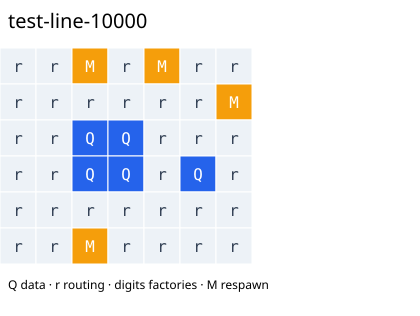

# Local-compilation benchmark results

This benchmark evaluates 20 circuits from eight families using **simulated
annealing** to generate custom grids. It compares them with three layout
generators built into liblsqecc: `edpc`, `compact` and `compact_no_clogging`.
Every reported score uses **wave scheduling with local instruction decomposition
enabled** (`-P wave --local`). See [the terminology guide](concepts.md) for these
independent compiler settings.

**Area** counts every tile in the rectangular grid. **Slices** count completed
compiler schedule frames. **Volume** is their product, in **tile-slices**.
Custom values select the best observed layout across seven magic-state supply
counts (1, 2, 4, 8, 16, 24 and 32) and two random seeds (61 and 62). Exported
per-count winners were freshly recompiled to verify their scores. These tables
summarize the saved experiment; rebuilding this site does not rerun it.

For each circuit, percentage reduction is
`100 × (best successful native volume − custom volume) / best successful native volume`.
The headline value averages those percentages with equal weight per circuit;
it is not a reduction in the sum of volumes across the entire corpus.

The mean per-circuit volume reduction against the best successful native layout
is **28.50%**, with custom wins on 20/20 comparable circuits. These are compiler
tile-slice results, not physical hardware estimates or a proof of general superiority.

## Circuit families

A circuit family groups inputs with related interaction structure or construction.
The corpus uses Clifford+T gates: general rotations are synthesized into this gate
set before layout optimization. The versioned input manifest is
`examples/corrected-v3/manifest.json`; the
[data provenance guide](history-status.md) explains the synthesis correction.

| Family | Meaning |
|---|---|
| Line | Synthetic interactions along a chain of qubits |
| Star | Synthetic interactions centered on a shared qubit |
| Matching | Synthetic interactions organized into disjoint pairs |
| Dense | Synthetic circuits with interactions across many qubit pairs |
| QFT | Quantum Fourier transform |
| Haar | Random unitaries drawn according to Haar measure, the invariant uniform distribution on the unitary group |
| QSP | Quantum signal processing: structured sequences of signal operations and phase rotations |
| QSVT | Quantum singular value transformation: structured sequences involving a block encoding and phase operations |

These are specific test instances, not coverage of every circuit in each family.

## Family and seed variation

A random seed initializes the search's pseudorandom choices. Each seed column
selects its best tested supply count per circuit, then averages per-circuit
percentage reductions. The pooled column also selects across both seeds. It
therefore describes the best observed outcomes, not an average single-run outcome.

| Family | Circuits | Pooled reduction | Seed 61 | Seed 62 |
|---|---:|---:|---:|---:|
| line | 3 | 30.27% | 30.27% | 18.73% |
| star | 3 | 15.92% | 13.20% | 1.65% |
| matching | 3 | 22.70% | 21.34% | 22.33% |
| dense | 3 | 25.54% | 25.25% | 10.76% |
| QFT | 1 | 30.32% | 30.32% | 5.31% |
| Haar | 3 | 45.44% | 45.44% | 38.30% |
| QSP | 2 | 29.10% | 29.10% | 21.90% |
| QSVT | 2 | 30.88% | 30.88% | 30.88% |

## Per-circuit comparison

All four volume columns use tile-slices. The supply count is the number of
abstract `M` cells in the selected custom grid. “No-clogging” denotes the native
`compact_no_clogging` generator; it is a separate baseline from `compact`.

| Circuit | Supply cells | Area (tiles) | Time slices | Custom volume | EDPC volume | Compact volume | No-clogging volume |
|---|---:|---:|---:|---:|---:|---:|---:|
| test-line-10000 | 4 | 42 | 218 | 9,156 | 13,122 | FAILED | FAILED |
| test-star-10001 | 4 | 56 | 227 | 12,712 | 13,932 | FAILED | FAILED |
| test-matching-10002 | 4 | 42 | 207 | 8,694 | 11,259 | 19,338 | 13,644 |
| test-dense-10003 | 16 | 56 | 163 | 9,128 | 12,960 | FAILED | FAILED |
| test-line-10004 | 4 | 42 | 242 | 10,164 | 15,552 | 20,922 | 14,706 |
| test-star-10005 | 8 | 56 | 171 | 9,576 | 13,203 | 16,896 | 11,682 |
| test-matching-10006 | 8 | 64 | 98 | 6,272 | 7,857 | FAILED | FAILED |
| test-dense-10007 | 4 | 63 | 166 | 10,458 | 11,988 | FAILED | FAILED |
| test-line-10008 | 4 | 40 | 180 | 7,200 | 11,097 | 14,388 | 10,242 |
| test-star-10009 | 16 | 64 | 122 | 7,808 | 9,882 | FAILED | FAILED |
| test-matching-10010 | 16 | 64 | 108 | 6,912 | 9,234 | 17,028 | 11,934 |
| test-dense-10011 | 16 | 48 | 163 | 7,824 | 11,907 | FAILED | FAILED |
| qsp-d3 | 8 | 48 | 4,729 | 226,992 | 319,140 | 738,177 | 546,192 |
| qsp-d7 | 8 | 48 | 10,075 | 483,600 | 684,288 | 1,562,517 | 1,151,082 |
| qsvt-d3 | 16 | 56 | 6,572 | 368,032 | 532,413 | FAILED | FAILED |
| qsvt-d7 | 16 | 56 | 15,328 | 858,368 | 1,241,973 | FAILED | FAILED |
| qft5 | 8 | 56 | 5,140 | 287,840 | 413,100 | FAILED | FAILED |
| haar-101 | 4 | 35 | 451,746 | 15,811,110 | 33,519,582 | FAILED | FAILED |
| haar-102 | 4 | 35 | 451,872 | 15,815,520 | 33,477,381 | FAILED | FAILED |
| haar-103 | 8 | 56 | 414,222 | 23,196,432 | 33,489,207 | FAILED | FAILED |

Native EDPC succeeded on 20/20 circuits; compact and compact_no_clogging each
succeeded on 7/20. Failed native runs are not counted as custom wins. The
comparison is against the best **successful** reference for each circuit.

## Example output grid

The selected line-circuit layout has 42 tiles and 218 slices (9,156 tile-slices).
It uses four M cells; their physical factory overhead is not represented.

## Budget and limitations

- 280 simulated-annealing runs with local compilation: seven counts × two seeds × 20 circuits.
- 32 budget slots per run, including two starting-layout choices. A slot counts
  even when a candidate fails or reuses a cached score.
- Previously optimized starting layouts (warm starts) carry earlier search cost; total historical
  optimization effort is not equalized against the native generators.
- Native layouts can differ in resources and preprocessing; results describe the
  declared compiler model rather than a controlled hardware-resource comparison.
- Only 22/140 inherited layouts compiled locally; failures were retained, not repaired invisibly.
- No hyperparameter optimization was performed. The selected layouts are the
  best found in this experiment, not proven global optima.

### Compiler accounting

| Quantity | Count |
|---|---:|
| Charged search slots | 8,960 |
| Evaluator score requests (including starting-grid evaluation) | 9,100 |
| New compiler invocations by the evaluator | 7,625 |
| Reused cached scores | 1,475 |
| Separate native/export reference calls | 120 |
| Separate winner replay calls | 140 |

See [the protocol and reproduction requirements](local-compilation.md).
The [compact JSON summary](_static/local-results.json) supplies the numbers on this page
without local filesystem paths or the full experiment archive.
